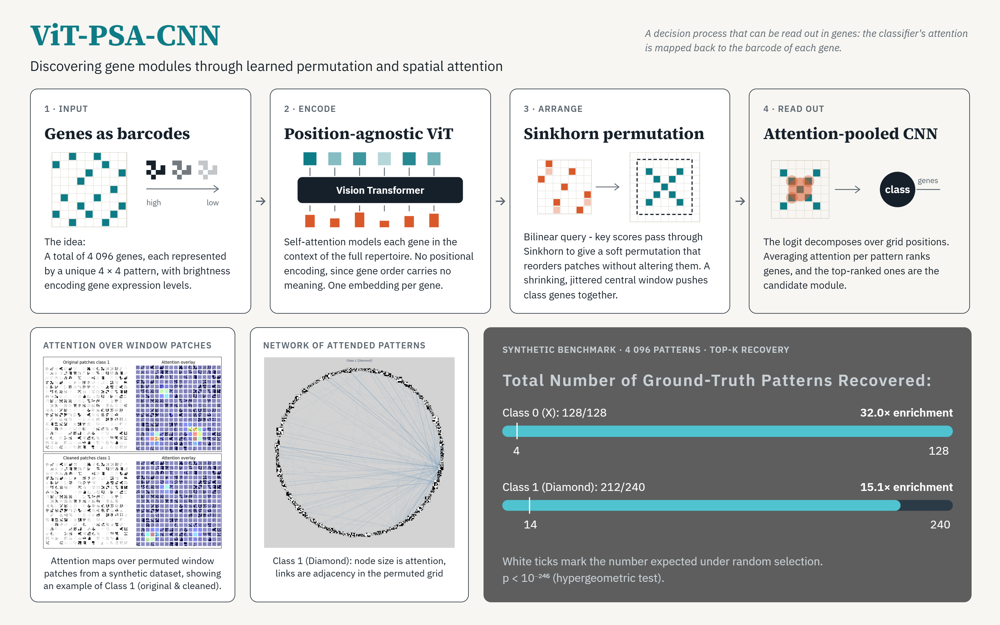
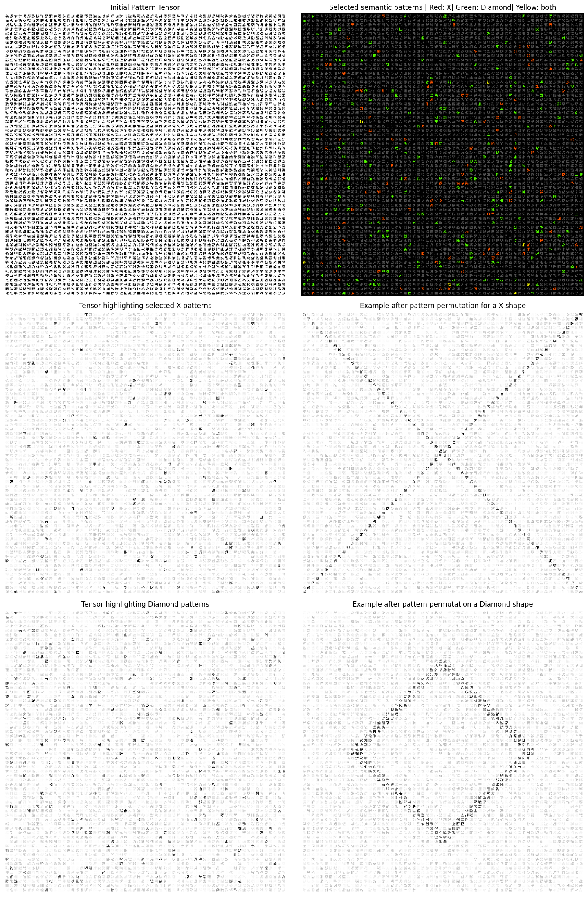
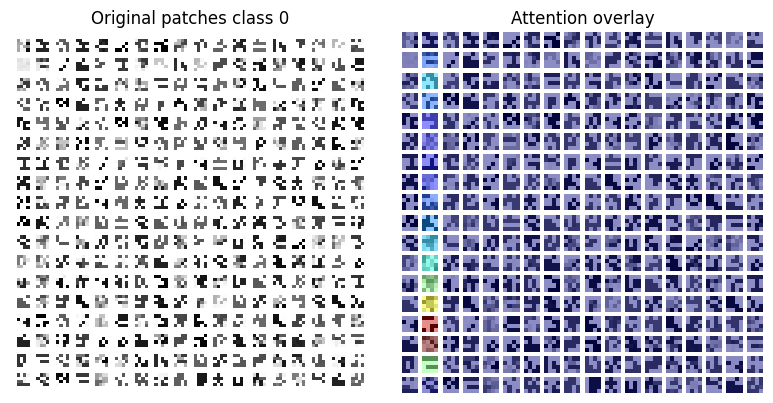
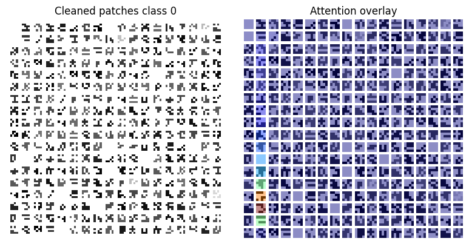
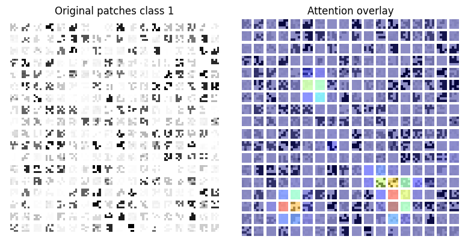
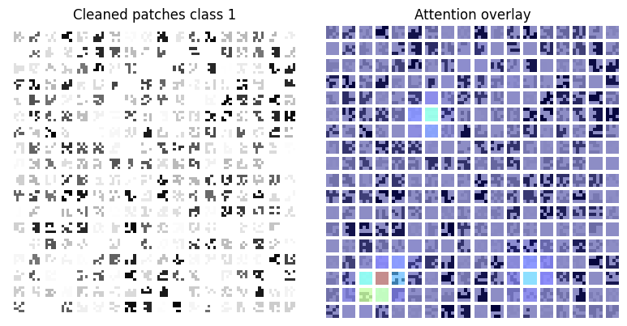
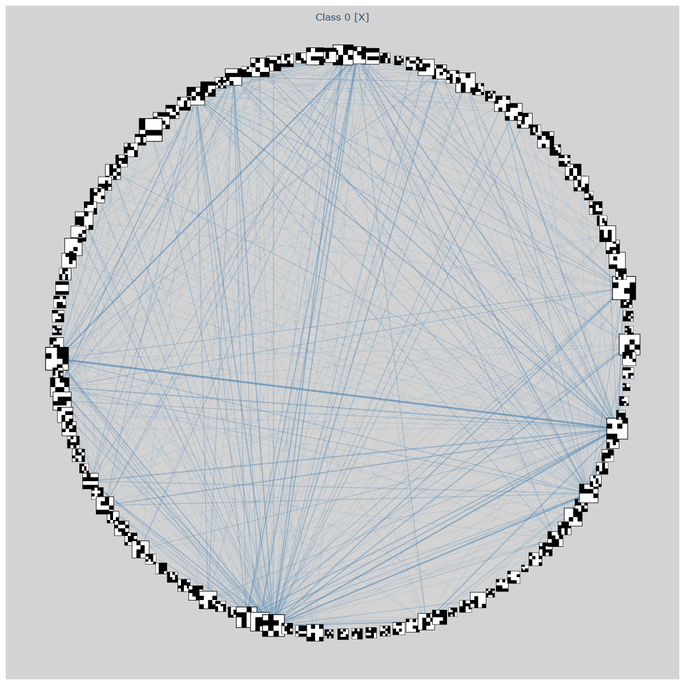
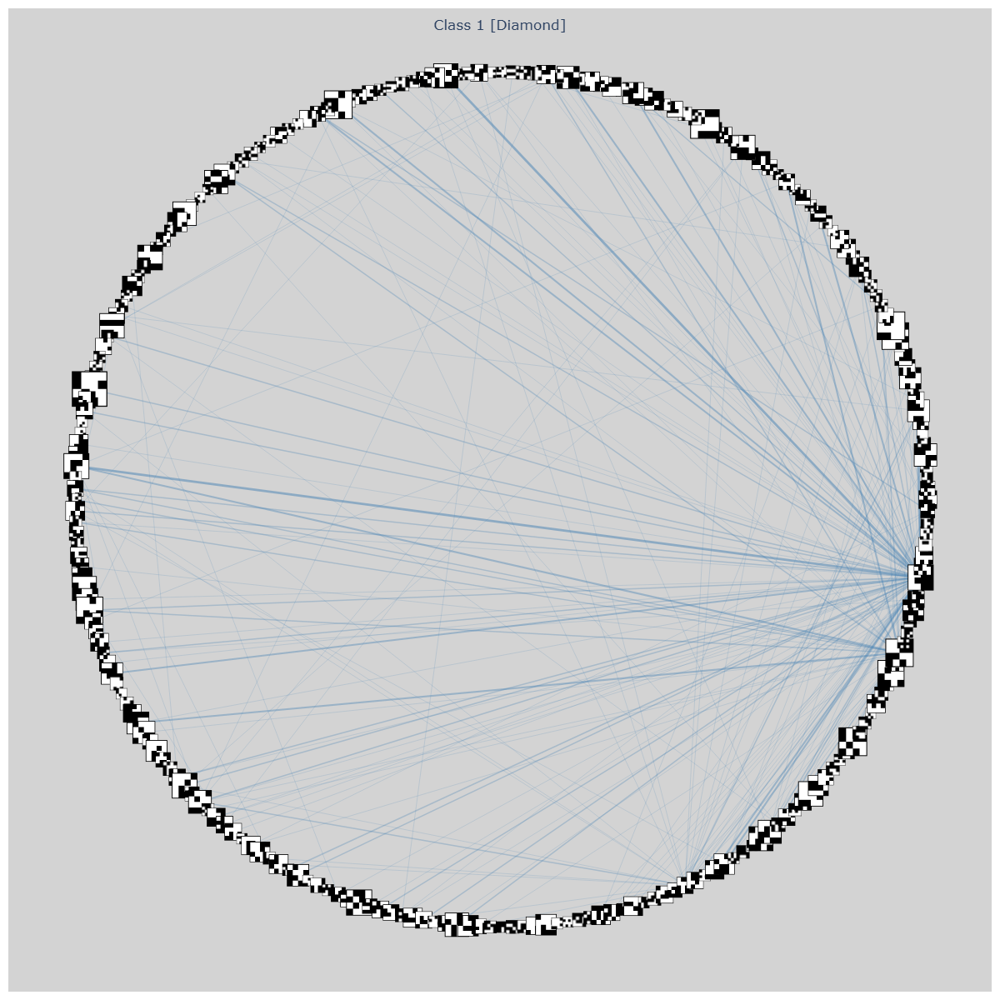

# ViT-PSA-CNN : *Discovering Gene Modules through Learned Permutation and Spatial Attention*

> A proof-of-concept neural architecture that learns class-specific patch permutations to surface unique class-defining patterns through attention-weighted pooling.

## Graphical Abstract

## Abstract

Cell states are created through interactions between many different genes. Identifying candidate gene modules remains challenging, as experimental perturbations are complex for high throughput screenings, while sequencing technologies are limited by the extreme dimensionality of the generated datasets. In contrast, deep learning architectures are increasingly capable of uncovering complex biological patterns that have remained difficult to detect by traditional methods. For instance, transformer-based models such as scGraphformer have demonstrated state-of-the-art accuracy in cell-identity classification. However, a fundamental limitation of these models is their inherent opacity. They function as *'black boxes'* that fail to elucidate the patterns that led to their classification decisions. This opacity obscures the molecular signatures, thereby leaving the specific drivers of cell-identity unknown.

To address this, I present ViT-PSA-CNN, a proof-of-concept architecture created to uncover combinatorial gene relationships and extract discriminative gene modules without explicit supervision. In this framework, input patches were designed to represent individual genes, where each patch encodes a unique pattern and intensity reflects expression levels. A position-agnostic Vision Transformer first encodes patch-level semantics, which are then processed by a Sinkhorn-normalized bilinear decoder. This decoder reorganizes the patches into a spatially coherent arrangement for classification via an attention-pooled CNN, thereby isolating the most class-discriminating patterns.

The architecture was validated on a controlled synthetic benchmark where the ground-truth signatures were known by construction but withheld from the model. Specifically, the dataset contained 4,096 unique patterns with randomly generated intensities. Class 0 was associated with an X-shaped signature comprising 128 patterns, while Class 1 was associated with a diamond-shaped signature consisting of 240 patterns. These signatures were generated by stochastically increasing the intensities of their patterns under class-specific permutations. The data were presented to the model in an unpermuted state. ViT-PSA-CNN achieved 100% test accuracy and recovered the ground-truth modules with hypergeometric enrichments of 32.0× (Class 0) and 15.1× (Class 1) over random chance ($p < 10^{-246}$). These results provide a proof of concept that, in a controlled setting, the architecture can recover known gene modules from its attention without access to them. Whether this holds for real single-cell data, which involve technical noise, dropout, downregulation and extensively shared gene programs between cell states, remains to be tested, and doing so is the next step toward identifying candidate gene modules associated with cell-state identity.

## Dataset and Model Weights

To ensure reproducibility and allow for independent verification of the results, the data and the final model state are hosted on the Hugging Face Hub.

*   **Synthetic Dataset:** 
    - A representative batch of $1\space000$ samples that can be used for evaluation is available at:  
    [huggingface.co/datasets/daniel-sampaio-goncalves/SyntheticPatterns](https://huggingface.co/datasets/daniel-sampaio-goncalves/SyntheticPatterns)
*   **Model Weights:** 
    - The trained parameters of the ViT encoder, the bilinear decoder, and the attention-pooled CNN are stored as safetensors at:  
    [huggingface.co/daniel-sampaio-goncalves/ViT\_PSA\_CNN](https://huggingface.co/daniel-sampaio-goncalves/ViT_PSA_CNN)

## Workflow

The practical implementation of the architecture and the evaluation pipeline is provided in a comprehensive tutorial as a Jupyter Notebook: [`vit_psa_workflow_.ipynb`](./vit_psa_workflow_.ipynb). 
___
___

# *ViT-PSA-CNN Paper*

| Version | Publication Date | Last revision |
| --- | --- | --- |
| 1.0.0 | 06 11 2026 | 06 11 2026 |

## Table of Contents
- [Intro](#intro)
- [Data-structure Design](#data-structure-design)
- [Model Architecture](#model-architecture)
    - [ViT](#vit)
    - [Decoding Strategy and Constraints](#decoding-strategy-and-constraints)
    - [Bilinear Compatibility Decoder](#bilinear-compatibility-decoder)
    - [Spatial Constraint and Windowing](#spatial-constraint-and-windowing)
    - [Attention-Pooled CNN](#attention-pooled-cnn)
- [Synthetic Data Benchmark](#synthetic-data-benchmark)
- [Training Strategy](#training-strategy)
    - [First Stage Training](#first-stage-training)
    - [Stochastic Regularization and Perturbations](#stochastic-regularization-and-perturbations)
    - [Optimization and Hyperparameters](#optimization-and-hyperparameters)
    - [Second Stage Training](#second-stage-training)
    - [Auxiliary Pattern Loss](#auxiliary-pattern-loss)
    - [Diversity Loss](#diversity-loss)
    - [Training Optimizations](#training-optimizations)
    - [Checkpoint Selection](#checkpoint-selection)
- [Results](#results)
    - [Evaluation Protocol and Pattern Cleaning](#evaluation-protocol-and-pattern-cleaning)
    - [Classification](#classification)
    - [Attention-based Ranking and Recovery of Class-defining Patterns](#attention-based-ranking-and-recovery-of-class-defining-patterns)
- [Discussion](#discussion)
- [References](#references)

***

## Intro

Cellular phenotypes emerge from coordinated interactions between many molecular processes operating within complex regulatory networks. While gene-expression profiling can already suggest candidate drivers for a given phenotype, it is rarely sufficient on its own. Systematic identification of functionally promising candidate gene modules remains challenging due to the high dimensionality of transcriptomic data and the technical noise inherent in sequencing assays. Moreover, inaccurate *in silico* candidate identification can lead to costly and time-consuming *in vitro* and *in vivo* validation experiments.

Modern deep-learning architectures, and in particular transformer-based models, excel at extracting latent structure from high-dimensional, unstructured data (Vaswani et al., 2023), and could therefore be a good alternative to traditional bioinformatic methods. However, their representational depth comes at the cost of interpretability: the internal geometry of learned embeddings remains difficult to interpret, making it challenging to identify the specific features driving classification decisions. For single-cell biology, this limitation obscures the molecular signature of primary interest, specifically identifying candidate combinatorial gene modules.

I therefore set out to design an architecture that encodes cell-level multi-modal information in a transformer, decodes the learned patch embeddings into an interpretable, spatially organised representation, and surfaces the individual genes most responsible for a given cell state assignment.

## Data-structure Design

A prerequisite for such an architecture is a data structure that satisfies two key constraints. First, it must accommodate an arbitrary number of phenotype-relevant modalities per cell such as gene and protein expression, transcript and protein turnover rates (e.g. production and degradation), and chromatin-associated features (e.g. DNA methylation and chromatin accessibility). In addition, it must preserve the identity of each individual feature (e.g. a single gene) throughout the network, enabling a straightforward post-hoc attribution.

Given these constraints, a reasonable input structure would be a 5-D tensor $\mathbf{X} \in \mathbb{R}^{B \times C \times N \times P \times P}$, where $B$ represents the number of cells, $C$ the number of modalities, and $N$ the number of gene-specific $P \times P$ barcodes. In these barcodes, the spatial foreground pattern identifies the gene, and the shared foreground intensity $\alpha \in (0, 1]$ encodes its relative expression, while the background intensity is set to 0. This spatial encoding was chosen to transform feature-level data into a patched image format, allowing for the design of a module architecture that leverages CNN-based attention and max-pooling operations, as discussed in the next section, while facilitating intuitive visualization of the input.

As the model architecture described in the following sections assumes a single modality, the dimension $C$ was omitted for simplicity and represent the input as a tensor $\mathbf{X} \in \mathbb{R}^{B \times N \times P \times P}$.

## Model Architecture

### *ViT*
___

Because genes typically act as coordinated modules within large-scale regulatory networks, the biological relevance of any single candidate gene is difficult to interpret without accounting for the activity of its surrounding network. Consequently, a biologically grounded deep-learning model must capture not only the semantics of individual genes but also their relationships within the context of the full gene repertoire. Transformer-based architectures are well-suited to this task, as self-attention computes interactions among all input tokens, enabling the modeling of long-range contextual dependencies and the learning of relational representations. A standard Vision Transformer (Dosovitskiy et al., 2021), for instance, operates by partitioning a spatial grid into non-overlapping patches and learning per-patch embeddings. It then models inter-patch relationships through self-attention, thereby integrating global context across spatially distant regions of the image.

Accordingly, the first module was implemented as a standard ViT encoder (12 transformer layers, 768-dimensional hidden states, 12 attention heads, and a 3072-dimensional feed-forward MLP) but without positional encoding. While positional information is not strictly required for the attention mechanism, it is typically incorporated in ViTs to encode the ordinal order of input tokens. In traditional image processing, this is informative because spatial location is often tightly coupled to feature semantics (e.g., a blue sky predominantly occupies the top rows). In the input, however, genes are assigned to arbitrary positions along the $N$ axis by design. Consequently, the ordinal order carries no inherent biological meaning, and the inclusion of positional encoding would introduce unstructured noise rather than a useful signal.

### *Decoding Strategy and Constraints*
___

The primary objective was to design a decoder architecture that is capable of converting the encoder's latent embeddings into a spatially interpretable representation. The key idea is to employ a final classification head consisting of an attention-pooled CNN, which not only performs cell-state classification but also generates a spatial attention map to highlight the specific class-relevant patches, and therefore, the specific candidate genes that should define a given cellular phenotype.

To achieve this, the decoder must build a 2D feature map where class-defining patches are strategically positioned. The initial Transfomer input is a tensor $\mathbf{X} \in \mathbb{R}^{B \times N \times P \times P}$, where $N$ is the number of genes and $P \times P$ is the spatial dimension of each patch. Within this structure, the specific spatial pattern of each patch identifies the gene, while the intensity of that pattern reflects its relative expression. To maintain the integrity of the biological signal, the decoding process must avoid arbitrary mixing or deformation of the patches as any distortion of the $P \times P$ patterns would compromise the CNN's ability to read out the underlying gene identity and expression intensity. Consequently, the decoding transformation must be restricted to a learned soft permutation of the patch indices, effectively reordering the genes without altering their individual representations.

This process is governed by a permutation matrix $\mathbf{S} \in [0, 1]^{N \times N}$. The resulting spatially organized tensor $\mathbf{X}' \in \mathbb{R}^{B \times N \times P \times P}$ is computed as:

$$
\mathbf{X}'_{b, i, :, :} = \sum_{j=1}^{N} S_{i j} \mathbf{X}_{b, j, :, :}, \qquad b \in \lbrace{1, \dots, B}\rbrace, \quad i \in \lbrace{1, \dots, N}\rbrace.
$$

To ensure that each slot in the output grid is occupied and that no gene is used more than once in a "hard" sense, $\mathbf{S}$ is constrained to be a doubly stochastic matrix. This imposes the following constraints on the rows and columns:

$$
\sum_{j=1}^{N} S_{i j} = 1, \quad \forall i \in \lbrace{1, \dots, N}\rbrace, \quad \mathrm{and} \quad \sum_{i=1}^{N} S_{i j} = 1, \quad \forall j \in \lbrace{1, \dots, N}\rbrace.
$$

While these constraints mathematically forbid the absolute duplication of a gene, as the total weight assigned to any gene $i$ across the grid is exactly $1$, the 'soft' nature of the assignment allows the model to exploit this by distributing the signal of a single highly discriminative gene across multiple slots. This behavior is leveraged via per-patch normalization during the analysis phase. By normalizing the intensity of each patch, the model effectively converts this signal distribution into a duplication of patterns. Furthermore, when a slot is populated by a low-confidence mixture of genes that fails to match the codebook patterns, it is treated as a null patch (zero-intensity). Together, these mechanisms encourage the model to isolate the most relevant gene modules against a neutral background before they are processed by the CNN. This strategy is further enforced through the use of specific loss functions, the restriction of the CNN's input window, and the application of annealing strategies to refine the discrete selection process, all of which are detailed in the subsequent sections.

Finally, the tensor $\mathbf{X}'$ is reshaped into a spatial grid $\tilde{\mathbf{X}} \in \mathbb{R}^{B \times 1 \times \sqrt{N}P \times \sqrt{N}P}$. Because the subsequent CNN utilizes a restricted, centralized receptive field, the decoder is incentivized to concentrate the most discriminative gene modules within the center of the spatial arrangement to minimize classification loss.

### *Bilinear Compatibility Decoder* 
____
While a discrete permutation matrix $\mathbf{S}$ would define the ideal one-to-one mapping, such a matrix is inherently non-differentiable, which poses substantial challenges for direct integration into gradient-based architectures trained via backpropagation. To address this, a bilinear compatibility decoder was implemented to generate a learned compatibility score between query and key embeddings, which determines the optimal assignment of genes to grid positions. By processing this score matrix through the Sinkhorn operator (Mena et al., 2018; Sinkhorn and Knopp, 1967), the model produces a differentiable, doubly stochastic assignment matrix that approximates a discrete permutation. This enables the model to learn which genes should occupy specific spatial locations, guided by the classification signal propagated from the downstream CNN.

Specifically, given the latent embeddings $\mathbf{Z} \in \mathbb{R}^{N \times D}$ produced by the ViT encoder, first a layer normalization is applied to stabilize the feature distribution. Then, to capture the relationship between the gene identities and the target grid positions, these normalized embeddings are projected into two distinct representation spaces: a query space $\mathbf{Q} \in \mathbb{R}^{N \times d}$ and a key space $\mathbf{K} \in \mathbb{R}^{N \times d}$, via two distinct multi-layer perceptrons (MLPs), denoted as $f_q(\cdot)$ and $f_k(\cdot)$ :

$$ \mathbf{Q} = f_q(\mathrm{LayerNorm}(\mathbf{Z})), \quad \mathbf{K} = f_k(\mathrm{LayerNorm}(\mathbf{Z})) $$

The two networks are deliberately asymmetric. $f_q$ consists of two linear layers with a GELU activation, whereas $f_k$ consists of three linear layers with SiLU and GELU activations. Both apply dropout ($p=0.1$) before their output layer. The compatibility between a query $\mathbf{q}_i$ and a key $\mathbf{k}_j$ is computed with a learned bilinear form:

$$ M_{ij} = \mathbf{q}_i^\top \mathbf{W} \mathbf{k}_j $$

where $\mathbf{W} \in \mathbb{R}^{d \times d}$ is a learnable weight matrix. The resulting score matrix $\mathbf{M} \in \mathbb{R}^{N \times N}$ is interpreted as the assignment of input patch $i$ (row) to grid position $j$ (column) and serves as the basis for the final spatial assignment.

The asymmetric design, in which separate networks produce queries and keys, was chosen so that the model can learn complementary rather than merely similar relationships. A dot product of a shared embedding prefers similar genes, whereas decoupled queries and keys allow genes with different but complementary functional roles to receive high compatibility. This is motivated by gene regulation. In biological systems, a given phenotype can often emerge from the coordinated activity of multiple genes. These genes interact through complex networks in which their effects can reinforce, complement, or oppose one another. For instance, Gene B may act as an enhancer that increases the activity of Gene A, without Gene A necessarily affecting Gene B in return.Similarly, Gene C may inhibit Gene D, which normally represses Gene A, thereby indirectly increasing the activity of Gene A. To accommodate directed relationships between genes with distinct functional roles, the decoupled query and key representations allow $M_{ij} \neq M_{ji}$, thereby enabling the decoder, in principle, to position complementary genes next to one another on the grid. However, this flexibility motivates the design rather than guaranteeing that complementary genes will occupy neighboring grid positions, as the model does not explicitly enforce such an arrangement. Instead, any such arrangement may emerge indirectly through the classification loss and the CNNs design as detailed in the next section. 

To transform the raw compatibility scores $\mathbf{M}$ into a differentiable approximation of a permutation matrix, the Sinkhorn-Knopp algorithm was applied. The score matrix $\mathbf{M}$ is interpreted as a matrix of log-scores, such that $\exp(\mathbf{M})$ defines a strictly positive kernel. To ensure numerical stability and prevent numerical underflow and overflow, the iterations are performed in log space. Starting from $\mathbf{A}^{(0)} = \mathbf{M}$, each of the $L$ iterations alternately normalizes the rows and columns via log-softmax operations:

$$
\tilde{A}^{(l)}_{ij} = A^{(l)}_{ij} - \log \sum_{j'} \exp A^{(l)}_{ij'} \qquad A^{(l+1)}_{ij} = \tilde{A}^{(l)}_{ij} - \log \sum_{i'} \exp \tilde{A}^{(l)}_{i'j}
$$

and the assignment matrix is 

$$ 
\mathbf{S} = \mathrm{Sinkhorn}(\mathbf{M}, L) = \exp\big(\mathbf{A}^{(L)}\big)
$$ 

The resulting matrix $\mathbf{S} \in \mathbb{R}^{B \times N \times N}$ is approximately doubly stochastic, with $S_{ij}>0$. Since column normalization is applied last, the column sums satisfy $\sum_i S_{ij}=1$, while the row sums approach one as the number of iterations $L$ increases. Thus, $\mathbf{S}$ serves as a differentiable "soft" permutation.

Finally, $\mathbf{S}$ is used to reorder the original input patches $\mathbf{X} \in \mathbb{R}^{B \times N \times P \times P}$. The resulting spatially organized tensor $\mathbf{X}' \in \mathbb{R}^{B \times N \times P \times P}$ is computed as:

$$ \mathbf{X}'_{b, j, :, :} = \sum_{i=1}^{N} S_{b, i, j} \mathbf{X}_{b, i, :, :}, \qquad b \in \lbrace{1, \dots, B}\rbrace, \quad j \in \lbrace{1, \dots, N}\rbrace, $$

where $S_{b,i,j}$ denotes the weight assigned to input patch $i$ for grid position $j$. Since the columns of $\mathbf{S}_b$ sum to one and its entries are nonnegative, each output patch is a convex combination of the input patches. When $\mathbf{S}_b$ is a hard permutation matrix, this operation reduces to an exact reordering of the input patches. In implementation, this is a batched tensor contraction (Einstein summation).

### *Spatial Constraint and Windowing*
___

To ensure that the model identifies robust, combinatorial gene modules rather than relying on isolated features, it is necessary to regularize the interaction between the permutation decoder and the classification head. Given the decoder's flexibility, it could exploit potential shortcuts to achieve a low classification loss without learning meaningful gene modules. For instance, it could place a single, highly discriminative gene at a position that is particularly easy for the CNN to detect. In addition, because the Sinkhorn operator produces a soft permutation $\mathbf{S}$, the decoder could spread the information carried by class-discriminative genes across the grid as a blurred average, rather than mapping each gene to a unique grid location through a near-discrete permutation.

To mitigate these issues and encourage the decoder to perform a discrete permutation of highly relevant patches, a spatial constraint is introduced in the form of a constricted window. Instead of passing the entire grid of $N$ output positions, a centered window of $M<N$ positions is selected, with $\sqrt{M}\in\mathbb{N}$. The selected positions are then arranged in row-major order on a $\sqrt{M}\times\sqrt{M}$ grid, creating the reshaped tensor $\tilde{\mathbf{X}}\in\mathbb{R}^{B\times 1\times \sqrt{M}P\times \sqrt{M}P}$.

Let $G=\sqrt{N}$ denote the side length of the patch grid, so that the decoder output is arranged as $\mathbf{X}\in\mathbb{R}^{B\times 1\times GP\times GP}$, with $P\times P$ pixels per patch. Instead of passing the full grid to the CNN, a square window of $m\times m$ patches, with $m\le G$ is selected. For a window with top-left origin $\mathbf{o}=(o_{\mathrm{row}},o_{\mathrm{col}})$, the selected patch set is

$$
\mathcal{W}(\mathbf{o},m)=\lbrace{o_{\mathrm{row}},\dots,o_{\mathrm{row}}+m-1}\rbrace\times\lbrace{o_{\mathrm{col}},\dots,o_{\mathrm{col}}+m-1}\rbrace,
$$

where each $(i,j)\in\mathcal{W}$ specifies the location of a selected patch in the full grid. Patches are arranged in row-major order and assembled into an $m\times m$ grid to form the CNN input

$$
\tilde{\mathbf{X}}\in\mathbb{R}^{B\times 1\times mP\times mP}.
$$

This constraint creates a structural bottleneck that pressures the decoder to concentrate the most informative genes within a confined spatial area as it ensures that a gene can influence the final classification only if the decoder assigns it to a position inside the window.

To further increase the pressure on the decoder and prevent it from overfitting to a fixed spatial location, two additional training strategies are employed: window annealing and spatial jitter. The window side length $m_t$ is progressively decreased over training, from an initial value $m_{0}$ to a minimum $m_{\min}$, according to a predefined schedule. In addition, at each training iteration $t$, the window is rigidly translated by a random integer offset $\boldsymbol{\delta}_t=(\delta_t^{\mathrm{row}},\delta_t^{\mathrm{col}})$ (in patches) to reduce dependence on a fixed window location, with components drawn independently as

$$
\delta_t^{\mathrm{row}},\delta_t^{\mathrm{col}}\sim\mathcal{U}\bigl(\lbrace{-r,\dots,r}\rbrace\bigr)
$$

where $r$ is the maximum jitter in patches. The offset is applied to the centered origin $\mathbf{c}_t=c_t\mathbf{1}$, where $c_t=\lfloor (G-m_t)/2\rfloor$ and $\mathbf{1}=(1,1)^\top$, and the result is clamped so that the window remains inside the grid:

$$ 
\mathbf{o}_t=\mathrm{clip}\Bigl(\mathbf{c}_t+\boldsymbol{\delta}_t,0,\mathbf{G}-m_t\Bigr).
$$

During training, the same offset is shared by all samples in the batch $B$, and because it is an integer number of patches, the window shifts by multiples of $P$ pixels, which preserves patch alignment. At inference, however, $\boldsymbol{\delta} = \mathbf{0}$ is enforced to set the window to the exact grid center. Thus, at iteration $t$, the CNN operates on $\tilde{\mathbf{X}}_{\mathrm{win}}\in\mathbb{R}^{B\times 1\times m_tP\times m_tP}$, cropped from the full $GP\times GP$ canvas at origin $\mathbf{o}_t$. 

The underlying hypothesis is that as $m_t$ is annealed, the available area shrinks, forcing the decoder to arrange the most discriminative genes in an increasingly compact region. In addition, the jitter $\boldsymbol{\delta}_t$ further partitions the window into two regions. Assuming $\mathbf{G} - m_t \ge 2r$, an *invariant core* is created. It is the intersection of all possible window positions, namely the central block of $(m_t-2r)^2$ patches. This region remains visible to the CNN at every iteration. The surrounding *periphery* is only visible for a subset of jitter draws, therefore, its patches are seen sporadically. Genes placed in the core thus provide a reliable signal, whereas genes in the periphery provide an intermittent one. Because the core shrinks together with the window, it can hold only a limited number of genes. If the signal within the core is insufficient for accurate classification, the resulting classification pressure will incentivize the decoder to place additional class-defining patterns in the periphery. 

However, since the set of visible peripheral patches varies across iterations, relying solely on a single peripheral gene becomes unreliable, because whenever the pattern falls outside the window, the CNN loses that classification signal. This matters because individual genes rarely define a given cell phenotype on their own. Phenotype, and therefore in this case, class evidence should typically emerge from combinations of genes. For instance, genes $A$ and $B$ may be jointly informative although neither is alone. If $A$ is placed in the core and $B$ in the periphery, the pair is intact only for the draws in which $B$ is visible. To classify accurately across draws, the decoder is therefore incentivized to place several such combinations, anchored in the core and extended into the periphery, so that their peripheral members are visible under different jitter draws (for example a second pair $\lbrace{C,D}\rbrace$ whose peripheral member $D$ is only visible where $B$ is not). Ideally, at least one complete module is then visible for every draw of $\boldsymbol{\delta}_t$. This becomes only true if the core cannot hold all required modules for an accurate classification, as otherwise the periphery is unnecessary. However, as $m_t$ shrinks, the core capacity $(m_t-2r)^2$ decreases, and the decoder is forced toward this jitter-covering, combinatorial placement. Consequently, these pressures encourage the decoder to arrange informative genes in a dense cluster at the center of the grid, thereby, to the extent that no single gene is sufficiently for accurate classification, discovering robust, spatially co-localized gene modules.

### *Attention-Pooled CNN*
___

To achieve this, the CNN is structured as two convolutional blocks followed by an attention-pooling head. The first block begins with a patch-embedding convolution, in which the windowed input $\tilde{\mathbf{X}}_{\mathrm{win}}\in\mathbb{R}^{B\times 1\times m_tP\times m_tP}$ is processed by a convolution whose kernel size and stride both equal the patch size $P$, without padding:

$$
\mathbf{E} = \mathrm{ReLU}\Big(\mathrm{GN}\big(\mathrm{Conv}_{P\times P,\mathrm{stride}=P}(\tilde{\mathbf{X}}_{\mathrm{win}})\big)\Big),
\qquad \mathbf{E}\in\mathbb{R}^{B\times H\times m_t\times m_t}
$$

where $H$ is the number of hidden channels and $\mathrm{GN}$ denotes Group Normalization. GN was chosen instead of Batch Normalization because its statistics are computed per sample and are thus independent of batch size, making it better suited to the small batch sizes used here.

Because the kernel size equals the stride, the filters tile the input into non-overlapping $P\times P$ blocks in such a way that each output position of the convolution is computed from exactly one patch and no information is mixed across patch boundaries. Therefore, each coordinate of $\mathbf{E}$ corresponds to a single gene patch pattern, which preserves the correspondence between grid positions and gene identities, to the extent that the decoder's permutation is near-discrete. The convolution is equivalent to applying a single shared linear projection to every flattened $P\times P$ patch, as in the patch embedding of a ViT, and reduces the spatial resolution by a factor of $P$. Since the weights are shared across positions, the same pattern receives the same embedding wherever the decoder places it. Information about neighboring genes is introduced only by the subsequent convolutions, which, being shared across positions, encode the relative arrangement of patches rather than their absolute grid location.

Then, the first block is completed by a $3\times 3$ convolution that lets each embedding interact with its eight neighbors in the grid:

$$
\mathbf{F}_1 = \mathrm{ReLU}\Big(\mathrm{GN}\big(\mathrm{Conv}_{3\times 3,\mathrm{stride}=1}(\mathbf{E})\big)\Big),
\qquad \mathbf{F}_1\in\mathbb{R}^{B\times H\times m_t\times m_t}.
$$

To further increase the receptive field of the feature representations a second block with two further $3\times 3$ convolutions is used, each followed by a GN and a ReLU activation:

$$
\mathbf{F}_2 = \mathrm{ReLU}\Big(\mathrm{GN}\big(\mathrm{Conv}_{3\times3}\big(\mathrm{ReLU}(\mathrm{GN}(\mathrm{Conv}_{3\times3}(\mathbf{F}_1)))\big)\big)\Big),
\qquad \mathbf{F}_2\in\mathbb{R}^{B\times H\times m_t\times m_t}.
$$

Since all $3 \times 3$ convolutions use stride 1 and a padding of 1, the spatial size $m_t \times m_t$ is preserved, ensuring that each coordinate of $\mathbf{F}_2$ remains associated with a specific grid position. Each additional $3 \times 3$ layer expands the receptive field by one patch in every direction. Consequently, a coordinate of $\mathbf{F}_1$ has a receptive field of $3 \times 3$ patches, while $\mathbf{F}_2$ extends this to $7 \times 7$ patches. Because the subsequent attention pooling combines these positions largely additively, the network can represent the joint presence and relative arrangement of genes only within a region of up to 49 patches, which bounds the scale at which gene combinations can be detected.

This receptive field acts as a structural bottleneck, as a gene combination can contribute to the classification as a single unit only if its members are placed within the same neighborhood. This should encourage the decoder to co-localize highly class-relevant patches in close proximity. In addition, because the permutation is computed from the latent embeddings of the Transformer, which is designed to capture global relations between genes, it is reasonable to assume that the surroundings of the most highly weighted positions (identified by the attention map described below) may contain auxiliary candidate genes. These genes may have been positioned nearby by the decoder based on the previous global context, even if they were not the primary drivers of the final classification decision by the CNN.

To perform the final cell-state classification and create the pooled attention map, $\mathbf{F}_2$ is transformed into a single vector by a learned spatial attention. First, a scoring function $\psi$ implemented as a $1 \times 1$ convolution, maps the hidden channels of $\mathbf{F}_2$ to a single scalar value for each grid position, and a softmax over all $m_t^2$ positions of the window converts the scores into attention weights:

$$
v_{b,i,j} = \psi\left(\mathbf{F}_{2,b,:,i,j}\right),
\qquad i,j\in\lbrace{1,\ldots,m_t}\rbrace,
$$

$$
a_{bij} = \frac{\exp(v_{bij})}{\sum_{k=1}^{m_t}\sum_{l=1}^{m_t}\exp(v_{bkl})}
$$

Consequently, $a_{bij}\ge 0$ and $\sum_{i,j}a_{bij}=1$ for every sample $b$, and flattening the spatial dimensions yields the attention map $\mathbf{A}\in\mathbb{R}^{B\times 1\times m_t^2}$. Since the weights share a fixed total of one, increasing the weight of one position lowers that of all others. Eventually during training, this competition tends to concentrate weight on the positions whose features most reduce the loss.

The feature map is then pooled into a single vector as the attention-weighted average

$$
\mathbf{z_b} = \sum_{i,j} a_{bij}\tilde{\mathbf{F}}_2[b,:,i,j]\in\mathbb{R}^{H},
$$

where $\tilde{\mathbf F}_2$ denotes $\mathbf F_2$ after channel-wise dropout (Dropout2d, rate 0.1), which is active only during training. It is applied to the features that are pooled but not to the inputs of the scoring function $\psi$, so the attention weights are computed from the unperturbed features. 

Since the weights sum to one, $\mathbf z_b$ is an average rather than a sum, thus, its scale does not depend on the number of positions, which keeps the classifier input comparable while the window side $m_t$ is annealed. After a second dropout (rate 0.3) on $\mathbf z_b$, a linear layer produces the scalar logit

$$
\hat{y}_b = \mathbf{w}^\top \mathrm{Dropout}(\mathbf{z}_b) + \beta,
\qquad \mathbf{w}\in\mathbb{R}^{H},\ \beta\in\mathbb{R},
$$

where $\mathbf w$ and $\beta$ are the weights and bias of the classifier. 

From the resulting logit $\hat{y}$, the probability of Class 1 is obtained by applying the sigmoid function, $\sigma{(\hat{y})}$. The network is trained using binary cross-entropy on the logit. Since the pooled vector is a weighted average of the position features with weights summing to one, and the classifier is linear, the logit at inference, where the dropout is inactive, decomposes exactly over grid positions as

$$
\hat{y}_b= \beta + \sum_{i,j} a_{bij} \ell_{bij},
\qquad \ell_{bij}=\mathbf w^\top\mathbf F_2[b,:,i,j],
$$

where $\ell_{bij}$ is the local score obtained by applying the classifier weights to the feature vector at position $(i,j)$. Consequently, each position contributes the product of its attention weight $a_{bij}$ and its local score $\ell_{bij}$ to the final logit. The attention map therefore indicates which grid coordinates receive greater attention, while the local scores determine whether their contributions favor or oppose Class 1.

Since each gene is encoded by a unique pattern, the patch at each coordinate can be matched back to its gene by looking up its pattern in the codebook of known patterns, which assigns the attention of a coordinate to a specific gene. However, since each position in $\mathbf F_2$ summarizes a $7\times7$ neighborhood of the patch grid, a high attention weight highlights a spatial region rather than an individual patch.

In summary, the proposed architecture transforms the classifier's internal attention into a gene-level readout. To identify the genes most relevant to a class, the trained model should be applied to a large, representative cohort of samples of that class. For each sample, the attention weight of every grid coordinate is then mapped back to the specific gene identity assigned to that position by the permutation decoder. Averaging these weights across the cohort generates a cohort-level importance score for each gene. Genes that consistently receive high attention are therefore likely to be those the classifier relies on, which makes them high-priority candidates for genes associated with the cellular phenotype assigned to that class. Because the average is taken per gene rather than per grid position, it does not require a gene to occupy the same position across samples. The ability of this architecture to recover known ground-truth signatures is evaluated on the synthetic proof-of-concept benchmark in the Results section.

### *Synthetic Data Benchmark*
___

The inherent noise and high dimensionality of real-world single-cell sequencing data make it difficult to disentangle artifacts from biological signals. To evaluate the ViT-PSA-CNN architecture and verify its ability to recover latent gene modules, a controlled synthetic benchmark was developed. It allows the model's performance to be quantified precisely by comparing the learned attention maps against known ground-truth modules, which are withheld from the model during training.

The synthetic dataset was designed to mirror the input constraints described in the Data-structure design section. It is a tensor $\mathbf{X} \in \mathbb{R}^{B \times N \times P \times P}$ of $B$ samples, each consisting of $N=4096$ patches with a resolution of $P=4$ pixels per side. Each patch represents one unique "gene" $n \in \lbrace{1,\dots,N}\rbrace$ and is defined by a unique binary barcode $\mathbf{O}n \in \{0,1\}^{P \times P}$, where $1$ denotes the foreground and $0$ the background. The $N$ barcodes were drawn at random from the $2^{16}=65\space536$ possible $4\times4$ binary patterns, excluding the all-zero pattern. Consequently, every gene has a unique and non-empty barcode whose identity is visually distinct and can be traced. The expression level of gene $n$ in sample $b$ is defined by a scalar $\gamma_{b,n} \in(0,1]$ that scales the entire foreground of its barcode:

$$
\mathbf{X}_{b,n}=\gamma_{b,n}\mathbf{O}_n
$$

This modulates the brightness of a patch while its underlying semantic pattern remains constant.

Next, to simulate cell states, two classes $c \in \lbrace{0,1}\rbrace$ were defined by the coordinated "overexpression" of class-specific patches $\mathcal{D}_c \subset \lbrace{1, \dots ,N}\rbrace$, where overexpression denotes an increase in the shared foreground intensity of the patterns in the module. Each module was constructed with a shuffle-mask-unshuffle procedure, ensuring that its geometric shape cannot be read directly from the order of the input patches. Specifically, for each class, a random permutation $\pi_c$ of $\lbrace{1, \dots ,N}\rbrace$ was drawn independently, which places pattern $n$ at position $\pi_c(n)$ of a $64 \times 64$ grid. 

In this permuted space, a geometric mask $\mathcal{M}_c$ was used to modulate the intensity $\gamma_n$ of the two classes. The two classes consist of an *X*-shape formed by the two full diagonals of the grid for Class 0, and the outline of a *Diamond* for Class 1. The module is the set of genes that the permutation places inside the mask,

$$
\mathcal{D}_c=\lbrace{\ n: \ \pi_c(n) \in \mathcal{M}_c\ }\rbrace,
$$

which gives $|\mathcal{D}_0|=128$ and $|\mathcal{D}_1|=240$ patterns. Then for each sample $b$ of any class $c_b$, the expression levels are drawn independently as

$$
\gamma_{b,n}\sim
\begin{cases}
\mathcal{U}(0.6,1.0), & n\in\mathcal{D}_{c_b},\\
\mathcal{U}(0.1,0.4), & \mathrm{otherwise}.
\end{cases}
$$

In addition, to test the model's ability to handle overlapping signals, a small degree of redundancy was introduced, such that 12 patterns are shared between both modules ($|\mathcal{D}_0\cap\mathcal{D}_1|=12$). Next, the inverse permutation $\pi_c^{-1}$ is applied to restore the members of each class $C$ to their original sequence along the $N$ axis. Consequently, module membership is fixed for each class, whereas the intensities vary from sample to sample. Patterns outside the module receive a baseline expression, and the 12 shared patterns are "overexpressed" in both classes. 

Because the patterns are scattered along the $N$ axis, the synthetic signal is not apparent in the input ordering. The objective of the architecture is not to reverse the original shuffle $\pi_c$, since the absolute index of a given biological gene in the grid would carries no inherent meaning as it would be placed arbitrarily. Rather, the intent is that the model must discover which subset of patterns consistently show high intensity for a given class and co-localize them within the spatial grid.

**Figure 1.Synthetic Dataset**. *The codebook of* $\mathit{4\space096}$ *unique binary patterns is used to generate class-specific modules (top left and right). Class* $\mathit{0}$ *(X-shape, red) and Class* $\mathit{1}$ *(Diamond-shape, green) are defined by subsets of these patterns, with yellow indicating shared genes. The middle and bottom panels illustrate the transition from the stochastically permuted input state (left), as presented to the model, to the recovered latent geometric structures (right) upon application of the ground-truth permutation* $\pi_c$*.*

While this benchmark serves as a necessary validation of the architecture's fundamental logic, it is intentionally designed with a high signal-to-noise ratio, so as to isolate the model's ability to recover latent structures from the stochasticity of real-world biological data. It therefore does not capture the biological and technical complexity of actual transcriptomic profiling, and it simplifies the problem in three respects.

First, it simplifies gene regulation. Class identity is defined solely by the overexpression of specific modules, whereas in biological systems the downregulation of genes is often as discriminative as their overexpression. In addition, the two modules share only 12 patterns, whereas real cellular phenotypes often share a substantial core of housekeeping and lineage specific genes, which makes the separation of class-specific modules considerably more challenging.

Second, real sequencing data is affected by technical noise and sparsity. Effects such as "dropout", where a gene is expressed but not detected by the sequencer, would remove individual members of a module from a sample, and the model would have to learn to tolerate or compensate for these gaps. In the synthetic data, intensities are continuous and reliable, which avoids this complication.

Third, because the intensity ranges of module and baseline patterns do not overlap, every pattern that belongs to only one module is individually sufficient to classify a sample. Consequently, genes that are informative only in combination cannot be represented.

This simplicity was a deliberate first step. While the architecture was designed to be compatible with combinatorial dependencies, the benchmark first asks a more basic question: can the architecture still retrieve the complete ground-truth module when a shortcut through a single gene is available? Testing genuinely combinatorial dependencies, in which genes are informative only jointly, is left for future work. 
Despite these simplifications, the benchmark offers something that real noisy single-cell data cannot. Since the ground-truth modules are known by construction, the architecture's ability to recover them can be quantified directly, in terms of recovery rate and enrichment among the most highly attended patterns. Recovering the ground truth under these controlled conditions is therefore a necessary, though not sufficient, condition for applying and testing the model to the stochastic and sparse data of biological transcriptomics. The same transparency makes it also possible to isolate and diagnose potential misalignments between the Transformer's embeddings, the decoder's permutation logic and the CNN's attention. This diagnostic role guided the design of the training strategies and optimization constraints described in the following sections, which are intended to discourage reliance on a few individual genes and to drive the model toward recovering the complete ground-truth modules. Because the setup is simple and fully controlled, it can also serve as a reference point for evaluating later improvements and more complex datasets.

## Training Strategy

### *First Stage Training*
___

Initial attempts to train the ViT-PSA-CNN end-to-end using a binary cross-entropy (BCE) loss resulted in suboptimal performance. Specifically, the permutation decoder failed to converge toward a discrete mapping, instead producing a "smeared" assignment matrix $\mathbf{S}$ that averaged signals across the grid. A reasonable hypothesis was that this occurred because the gradients propagated from the CNN through the Sinkhorn operator to the ViT were too weak or noisy to effectively guide the encoder in creating the highly discriminative latent embeddings $\mathbf{Z}$ required for a precise permutation.

To resolve this, a two-stage training strategy was adopted. The ViT encoder was first pre-trained in isolation as a standalone binary classifier, thereby bypassing the decoder and CNN. The objective of this phase was to encourage the ViT to extract class-relevant semantics and model the combinatorial relationships between patches before being tasked with organizing them spatially. By initializing the encoder with a fully pre-learned representational space, the subsequent permutation decoder was provided with a stable and informative signal, reducing the optimization burden on the end-to-end architecture.

### *Stochastic Regularization and Perturbations*
___

Given the simplicity of the synthetic dataset, a standard ViT could achieve near-perfect accuracy because it may rely on one or a small subset of highly discriminative "shortcut" patterns. However, for the architecture to successfully recover entire gene modules, the encoder must be encouraged to learn a more generalized and robust representation of the data. To achieve this, a suite of stochastic transformations was introduced during pre-training to increase the task difficulty relative to the evaluation phase.

First, although the ViT encoder is permutation-invariant by design due to the omission of positional encodings, the order of patches along the $N$ axis was explicitly randomized for every training sample. As a good practice, this guards against cases in which the input ordering reflects biological conventions, technical artifacts, or residual structure introduced by the synthetic data generation.

Next, to prevent the model from overfitting to a few dominant features, a dynamic masking strategy was implemented. For each sample $b$, each patch $n$ was independently set to zero (effectively removing the pattern's identity and expression) with a probability $p_{mask}$. The masking ratio $p_{mask}$ followed a linear annealing schedule. It was held at $0.5$ for the first four epochs, increased linearly to $0.95$ by epoch 20, and was set to $0.90$ for the remaining epochs. 

However, although not tested in a controlled and quantitative manner, preliminary runs showed that higher masking ratios still caused the decoder, once combined with the pre-trained encoder, to rely on a single (or very few) class-relevant patch instead of a diverse set of patches. A plausible reason is that at high masking ratios only a few class-defining patterns remain visible in each sample, so that any individual pattern may suffice for classification. To counteract this, masking was skipped entirely ($p_{mask}=0$) in 10% of the training iterations, which in these runs appeared to improve the diversity of the decoder's ordering. It was reasoned that unmasked batches expose the transformer to the complete set of patches simultaneously, which may discourage specialization on small subsets and reduces the mismatch with the unmasked inputs used during evaluation. Masking continued to increase after test accuracy had saturated, so that the encoder remained challenged with fewer visible patterns.

Lastly, in biological systems, the mere presence or absence of a gene (its identity) within a dataset can itself carry functional significance. Although gene expression levels may vary due to technical noise, low signal, or intrinsic cell-to-cell stochasticity, the presence of genes belonging to functional modules strongly associated with a particular biological process can already provide valuable information about a cell's state, even without precise knowledge of their expression levels. Thus, to encourage the encoder to prioritize pattern identity over exact intensity values, each sample had a 10% probability of undergoing intensity coarsening. Let $\gamma_{b,n,i,j}$ denote the intensity of pixel $(i,j)$ in patch $n$ of sample $b$. The pixel intensities were mapped uniformly to a three-level discretized set $\{0, 0.1, 1.0\}$ according to the following rule:

$$ 
\gamma_{b,n,i,j}^{\mathrm{coarse}} = 
\begin{cases} 
1.0, & \mathrm{if\space } \gamma_{b,n,i,j} > 0.5 \\
0.1, & \mathrm{if\space} 0 < \gamma_{b,n,i,j} < 0.5 \\
0, & \mathrm{if\space} \gamma_{b,n,i,j} = 0
\end{cases}
$$

This perturbation is thought to reduce the model's dependence on the continuous intensity signal and should improve robustness to the magnitude variations typically encountered in real-world transcriptomic data.

### *Optimization and Hyperparameters*
___

The pre-training phase was optimized using the AdamW optimizer **(Loshchilov & Hutter, 2019)** with a learning rate of $10^{-4}$ and a weight decay of $3 \times 10^{-4}$ with a single BCE loss function. A dataset of $10\space000$ training samples with a batch size of $64$ was used. The learning rate was linearly warmed up over the first five epochs and subsequently decayed to $10^{-6}$ using a cosine annealing schedule (Loshchilov & Hutter, 2017) over a total of 23 epochs. To maintain numerical stability, gradients were clipped to a global norm of $1.0$, and all forward passes were executed using *bfloat16* autocast to optimize memory throughput. During this phase, only the parameters of the ViT (patch embedding, class token, transformer layers, and classification head) were updated. Evaluation was performed on a fixed and unperturbed patch sequence instead.

### *Second Stage Training*
___

Once the ViT had been pre-trained, the permutation decoder, the Sinkhorn operator, and the attention-pooled CNN were added, to train the complete architecture end-to-end. The ViT was initialized from one of the pre-trained checkpoints (patch embedding, class token, and transformer layers). In this stage, none of the input augmentations or perturbations of the first stage were applied. Consequently, the encoder received the same unmodified input $\mathbf{X}$ to which the assignment matrix $\mathbf{S}$ was applied, in which the patch at position $k$ corresponds to the codebook pattern with index $k$.

Two problems had to be addressed in this stage, arising from the simplicity of the synthetic dataset and from the soft nature of the assignment. First, given the simplicity of the dataset, a few highly discriminative patterns may be sufficient for classification. Second, although the Sinkhorn operator generates $\mathbf{S}$ an approximately doubly stochastic, such a matrix is merely a soft permutation. Because the rows sum to approximately one, a single input patch cannot be placed at several grid positions with its full signal. However, its signal can be divided among several positions, and each output position can be a convex combination of several input patches. The decoder could therefore produce blended patches that correspond to no genuine pattern. Similarly, it could also reproduce the same pattern at multiple positions of the grid, each with only a fraction of its signal. Combined with the first problem, this allows the decoder to exploit a single discriminative pattern by spreading it across the window instead of selecting many distinct class-defining patterns. To address this, two losses were added to the BCE classification loss. First, an auxiliary pattern loss, which shifts the permuted patches and its intensity within the CNN window towards the exact genuine patterns from the initial input $\mathbf{X}$. This is meant to reduce blended patches and divided signals. Additionally, a diversity loss is added, which discourages the repeated use of the same pattern at multiple positions.

### *Auxiliary Pattern Loss*  $\mathcal{L_{aux}}$
___

For the auxiliary loss, each of the $m_t^2$ patches $\tilde x_{b,w}\in\mathbb{R}^{P\times P}$ of the window of sample $b$ was first min-max scaled to $[0,1]$ and then thresholded at $0.5$ to obtain a binary pattern $\mathbf{c}_{b,w}$ :

$$
\bar{x}^{i,j}_{b,w}=\frac{\tilde{x}^{i,j}_{b,w}-\min_{i',j'}\tilde{x}^{i',j'}_{b,w}}{\max_{i',j'}\tilde{x}^{i',j'}_{b,w}-\min_{i',j'}\tilde{x}^{i',j'}_{b,w}+\epsilon}
\qquad
c^{i,j}_{b,w}=
\begin{cases}
1 & \text{if } \bar{x}^{i,j}_{b,w}\geq 0.5\\
0 & \text{otherwise}
\end{cases}
$$

where $\epsilon=10^{-8}$ avoids a division by zero. Before matching, patches were filtered according to the mean distance of their unscaled pixel values from the nearest binary value:

$$e_{b,w}=\frac{1}{P^2}\sum_{i,j}\min\bigl(\tilde{x}^{i,j}_{b,w},\,1-\tilde{x}^{i,j}_{b,w}\bigr)$$

where patches with $e_{b,w}>0.37$ were zeroed out ($c_{i,j}^{b,w}=0,\quad \forall i,j$). The binary patterns of the remaining patches were compared with the codebook of the $N$ known patterns, and a patch was considered matched if its binary pattern was identical to one of them. Let $k(b,w)$ denote the index of the matched pattern and $\mathcal{V}$ the set of matched patches. The target of a matched patch was the intensity patch of that pattern in the original input $\mathbf{X}_{b,k(b,w)}$, and the auxiliary loss was the mean squared error between the two:

$$\mathcal{L}_{\mathrm{aux}}=\frac{1}{|\mathcal{V}|}\sum_{(b,w)\in\mathcal{V}}\frac{1}{P^{2}}\sum_{i,j}\bigl(\tilde{x}^{i,j}_{b,w}-X^{i,j}_{b,k(b,w)}\bigr)^{2}$$

In this case, a squared error was chosen because it penalizes large deviations from the original pattern more strongly than small ones. Since the min-max scaling makes the matching insensitive to overall intensity, a patch carrying only a fraction of a pattern's signal can still be matched to it. The squared error penalizes such a patch stronger as the deviation grows, which should favor concentrating the full signal at fewer positions and intensities close to those of the original patch. Although the thresholding, filtering, and codebook matching are non-differentiable, they only determine which patches are selected and which target each is compared with, and are therefore treated as constants. But because the squared error between the continuous decoder patch and its target is differentiable, the gradients can reach the decoder through $\tilde{\mathbf{x}}_{b,w}$ and the Sinkhorn operator. The loss should thereby encourage the decoder to permute patterns into patches that resemble the input pattern in both shape and intensity, which should keeps the patterns recognizable even after a subsequent cleaning step. In contrast, Patches that matched no original pattern receive no gradient from this term.

### *Diversity Loss* $\mathcal{L_{div}}$
___

Next, to counter the fact that with the auxillary loss, the model may still concentrate on a very few highly class relevant pattern spread across multiple grid positions another loss, called diversity loss, was designed $\mathcal{L_{div}}$ that encourages the model to diversify the overall patterns in the cnn window. 

To build the diversity loss, each patch $m_t^2$ within the CNN window was assigned a category $z_{b,m}$ equal to its matched codebook index, with all unmatched patches sharing one additional "blank" category. Let $\mathcal D_{b}= \lbrace (m,m'):m\neq m', \space \mathcal z_{b,m}= \mathcal z_{b,m'} \rbrace$ be the pairs of patches within a sample that share a category, and $s_{b,m,m'}$ the cosine similarity between the (non-negative) patches. Then:

$$\mathcal{L}_{\mathrm{div}}=\frac{1}{B}\sum_{b=1}^{B}\frac{1}{\max(1,|\mathcal{D}_b|)}\sum_{(m,m')\in\mathcal{D}_b}s_{b,m,m'}$$

This loss is zero when no category occurs more than once. Since it is normalized by the number of duplicate pairs, it reflects how similar repeated patches are rather than how often they occur. Unmatched patches were grouped into one category so that producing patches that match no pattern is not rewarded. The two terms partly oppose each other, since the auxiliary loss pulls repeated patches toward the same target while the diversity loss penalizes their similarity. Consequently, the optimal learning path should be replacing a repeated patch with a different pattern. This will result in a lower diversity loss while still satisfying the constraints of the auxiliary pattern loss. As such, the total loss was computed as 

$$
\mathcal{L}=\lambda_{\mathrm{BCE}}\mathcal{L}_{\mathrm{BCE}}+\lambda_{\mathrm{aux}}\mathcal{L}_{\mathrm{aux}}+\lambda_{\mathrm{div}}\mathcal{L}_{\mathrm{div}}
$$

where $\lambda_{\mathrm{BCE}}=0.5$ and $\lambda_{\mathrm{aux}}=\lambda_{\mathrm{div}}=1$. 

The loss weights $\lambda$ were chosen empirically as a necessary compromise between class-specific guidance and structural regularization. While $\mathcal L_{\mathrm{BCE}}$ is the sole loss term that incentivizes the selection of class-relevant patterns, it is inherently susceptible to "shortcut learning", especially when a very simple dataset is used. Consequently, the classification objective can be satisfied by superficial features or a single pattern "smeared" across multiple positions, without reconstructing distinct, class-relevant patches, whose recovery is ultimately the goal of this architecture. Because the decoder is also initialized with weights from a pre-trained Transformer, the system already possesses knowledge of class-relevant regions. The primary challenge is therefore ensuring that the CNN recognizes these signals through a structurally sound soft permutation, rather than relying on the aforementioned shortcuts. By assigning a lower relative weight to $\mathcal L_{\mathrm{BCE}}$, the classification gradient is discouraged from dominating the pattern-fidelity and diversity terms.

### *Training Optimizations*
___

Regarding the annealing of the CNN input the windowed input $\tilde X_{win}\in \mathbb{R}^{B\times 1\times m_tP\times m_tP}$ described in the previous sections, the window schedule was instantiated as follows. The side length $m_t$ decreased linearly from $m_0=24$ to $m_{\min}=12$ patches over the first 10 epochs and was constant afterwards, while the maximum jitter $r$ increased stepwise from 0 to 3 patches by epoch 8. In $25$% of the training batches, the annealed window size was replaced by a random size between 18 and 22 patches, with the jitter unchanged. In preliminary runs, the model tended to overfit or misidentify patterns as class-defining during the late stages of annealing, which is plausible because a small window makes memorizing a few patterns sufficient. The occasional larger windows were expected to help retain the general relationships learned earlier. During evaluation, a fixed window of 18 patches without jitter was used.

Model parameters were grouped by module for optimization. The pre-trained ViT was assigned a base learning rate of $10^{-7}$, while the decoder, Sinkhorn, and CNN modules were set to $10^{-3}$. Training was performed using AdamW with a weight decay of $3\times10^{-4}$, a batch size of $18$, and $35$ epochs over a subset of $3\space000$ samples. The learning rate schedule consisted of a $5$-epoch linear warm-up, $2$ epochs at the base rate, a $26$-epoch cosine decay toward a shared floor of $10^{-5}$, and a final $2$-epoch linear decay to $1$% and then $0.1$% of each group's base rate. Finally, to ensure numerical stability, gradients were clipped to a global norm of 5, forward passes utilized bfloat16 autocast, and batches resulting in non-finite gradient norms were skipped.

Notably, as the shared floor exceeds the ViT's base rate, the ViT's learning rate effectively increases from $10^{-7}$ to $10^{-5}$ during the cosine phase, while the rates for the other modules decrease from $10^{-3}$ to $10^{-5}$. This inverse trajectory was designed to mitigate the impact of unstable gradients produced by the randomly initialized decoder and CNN. By maintaining a minimal initial learning rate, the pre-trained embeddings $\mathbf{Z}$ are guarded against being distorted by the noise propagated through the Sinkhorn operator during the early stages of training. Subsequently, as the decoder and CNN modules converge, the gradients reaching the encoder become more informative. This allows the ViT to undergo fine-grained adjustments to $\mathbf{Z}$, harmonizing the embeddings with the decoder's compatibility scores that were not captured during the ViT's original BCE-based pre-training.

This process results in a final joint fine-tuning phase in which all modules operate at a common, reduced learning rate. Although the specific contribution of this inverted learning-rate schedule was not explicitly isolated through controlled ablation experiments, its design was motivated by the aforementioned considerations regarding training stability and the preservation of pre-trained representations. Thus, the adopted schedule represents a theoretically motivated optimization strategy rather than an empirically validated optimal configuration. 

### *Checkpoint Selection*
___

Model checkpoints were initially filtered based on performance thresholds, specifically requiring test and training accuracies to exceed $90$% and $80$%, respectively. However, since accuracy alone is not a sufficient indicator of whether class-defining patterns were correctly identified, the saved checkpoints were also inspected qualitatively. Attention maps and single-class samples were examined, prioritizing checkpoints where attention was concentrated on specific patterns rather than spread indistinctly across the window. In addition, the resulting permutations were analyzed for their proximity to a hard assignment, and the number of distinct patterns placed within the window was compared between checkpoints, with a preference for those exhibiting higher pattern diversity. Finally, from this filtered set, a representative checkpoint was selected, and its weights were subsequently used to compute the averaged results and enrichment statistics reported in the next section.

## Results

### Evaluation Protocol and Pattern Cleaning. 
___

For evaluation, the trained model was run on the unperturbed input with the fixed evaluation window of $18 \times 18$ patches without jitter, and the soft-permuted patches inside the window were then cleaned.Cleaning followed the method used in the auxiliary loss. Specifically, each window patch was min-max scaled and binarized at $0.5 and patches whose unscaled pixels deviated on average by more than $0.37$ were discarded. Only patches matching one of the $N$ known binary patterns in the codebook were retained and subsequently replaced with the corresponding input pattern's original intensity values. The cleaned grid was then passed through the attention-pooled CNN alone, so that classification and attention were obtained exclusively from genuine patterns.

### Classification
___ 

The model checkpoint used in this analysis reached $100$% accuracy on the test set of $2\space000$ samples. On a separate test set of $36$ samples, replacing the soft-permuted patches with their cleaned counterparts did not affect classification accuracy, suggesting that the input patterns preserved after cleaning were sufficient for accurate classification. For the individual samples presented in Figure 2, the decoder outputs and cleaned grids show largely similar patterns. Most of the original patterns were preserved during cleaning, with the main changes consisting of corrections to minor intensity deviations within the foreground. 

In addition, since the attention was recomputed by passing the cleaned grid through the CNN, its similarity is quite informative. The CNN was trained on the soft-permuted decoder output and never saw cleaned inputs, in which every patch is an exact original pattern and unmatched patches are zeroed. Therefore, if its attention had relied on residual blending or intensity noise in the decoder output, removing these should have changed where the CNN attends. Instead, the attended positions remained largely the same, with minor shifts, which suggests that the attention is generally driven by the genuine patterns and their positions rather than by artifacts of the soft permutation. 

This also supports the use of cleaned patches in the analysis that follows. In real sequencing data, the aim is to work with the measured gene expression values themselves, not with a soft-permuted approximation, which may distort the true intensities of the patterns. Cleaning restores each retained patch to its exact original input pattern and intensity, ensuring that the attention maps, and consequently the candidate genes derived from them, correspond to actual genes and their measured expression levels rather than potential artifacts introduced by the soft permutation. The trade-off is that patches that cannot be matched to a known pattern are discarded. Since the attended positions remained largely stable after cleaning, the removal of unmatched patches and the restoration of the original intensities seems to have had little effect on the patterns the CNN relies on. Nevertheless, some shifts in attention are expected, as both operations can alter the input to the CNN. However, the objective of this module is to identify a substantial set of candidate genes rather than to recover all of them. 

**Figure 2. Window patches and the attention of the CNN's pooling layer for one sample of each class, shown for the decoder output and after cleaning**. *The rainbow colour map represents attention intensity, with blue indicating the lowest attention and red the highest.*

### Attention-based Ranking and Recovery of Class-defining Patterns.
___ 

To identify the patterns on which the CNN relies, a network graph for each class was created (Figure 3). Specifically, the pooling layer's attention weights were averaged separately for each class across $1\space000$ samples randomly selected from the entire dataset of $1\space000\space000$ samples. Before averaging, the attention weights $a_{b,w}$ were min-max normalized independently for each sample $b$ across all window positions $w$, according to:

$$
\tilde a_{b,w}=\frac{a_{b,w}-\min_{w'}\space a_{b,w'}}{\max_{w'}\space a_{b,w'}-\min_{w'}\space a_{b,w'}+\epsilon}
$$

with $\epsilon=10^{-8}$ and values below $10^{-4}$ set to zero, ensuring that samples with uniformly low attention are not under-weighted relative to samples with high attention. Next, let $\mathcal{W}_{b,k}$ denote the set of window positions of sample $b$ whose cleaned patches matched pattern $k$. The size of node $k$ for class $c$ was calculated as the mean of the maximum attention weights across all samples belonging to that class. Consequently, when a pattern occurred multiple times in a sample, only the occurrence with the highest attention weight was considered:

$$s_k=\frac{1}{|\mathcal{B}_c|}\sum_{b\in\mathcal{B}_c}\max_{w\in\mathcal{W}_{b,k}}\tilde a_{b,w}$$

where the maximum over an empty set is zero. The weight of the link between patterns $k\neq l$ was the number of times they occupied horizontally or vertically adjacent window positions across all samples of the class, in either order. These links indicate which patterns the decoder placed next to each other. They were visualized as a network (Figure 3), with node sizes proportional to $s_k$, but were not evaluated quantitatively.

**Figure 3. Class-specific network graphs illustrating the patterns identified by the CNN and their spatial co-occurrence**. *Each node represents a pattern identified from the cleaned patches, with node size proportional to its mean maximum normalized attention weight across samples belonging to the corresponding class. Edge weights represent the number of times two patterns occupied horizontally or vertically adjacent window positions across the samples of that class, regardless of their order. Thus, larger nodes indicate patterns receiving higher attention, while "thicker" connections indicate more frequent spatial adjacency between patterns in the decoder's output. The networks are intended as a qualitative visualization of class-specific patterns and their spatial relationships.*

Subsequently, the patterns were ranked by $s_k$ per class (Table 2).

| Rank | Pattern ID (Class 0) | Class 0 labels | Node Size (Class 0) | Pattern ID (Class 1) | Class 1 labels | Node Size (Class 1) |
| --- | --- | --- | --- | --- | --- | --- |
| 1 | 368 | X | 0.048341 | 1494 | Diamond | 0.009687 |
| 2 | 4016 | X | 0.045866 | 2715 | Diamond | 0.008295 |
| 3 | 2213 | X | 0.043635 | 1768 | Diamond | 0.007284 |
| 4 | 2877 | X | 0.043159 | 1049 | Diamond | 0.006804 |
| 5 | 3828 | X | 0.042553 | 921 | Diamond | 0.006704 |
| 6 | 1116 | X | 0.040088 | 306 | Diamond | 0.006643 |
| 7 | 2864 | X, Diamond | 0.039894 | 4014 | Diamond | 0.006625 |
| 8 | 2858 | X | 0.038762 | 1996 | Diamond | 0.006619 |
| 9 | 960 | X | 0.038590 | 1398 | Diamond | 0.006579 |
| 10 | 1678 | X | 0.037956 | 2065 | Diamond | 0.006559 |

**Table 2. 10 most attended patterns identified by the CNN for each class.** *Patterns are ranked in descending order according to their attention-based importance scores. Pattern IDs is the index of each individual pattern in the codebook, labels indicate their associated ground-truth categories, and sizes represent the mean maximum normalized attention weights across samples belonging to the corresponding class.*

To quantify how many of the known patterns were recovered, the top $K$ per class were compared with the signature patterns known from the data generation, where $K$ equals the size of the signature. Namely, $128$ patterns for class 0 and $240$ for class 1 where shared patterns were counted by both classes as correct. In this case, because $K$ equals the number of ground-truth patterns, precision and recall are identical. The statistical significance of the identified patterns was evaluated using a hypergeometric test, comparing the top $K$ patterns against a random selection from the $N=4096$ available patterns. With $x$ correct patterns among the $n=K$ selected patterns, the p-value was computed as $P(X\geq x)$, and enrichment as $(x/n)/(K/N)$ (Table 3).

| Metric | Class 0 | Class 1 |
| --- | --- | --- |
| Ground-truth patterns | 128/4096 | 240/4096 |
| Random expected | 4.00/128 (3.12%) | 14.06/240 (5.86%) |
| Correctly identified | 128/128 (100.0) | 212/240 (88.3%) |
| Enrichment | 32.0x | 15.1x |
| p-value | $1.188 \times 10^{-246}$ | $1.203 \times 10^{-288}$ |

**Table 3. Identification of ground-truth patterns by the CNN for each class.** *The table reports the number and proportion of ground-truth patterns among all* $4\space096$ *patterns, the expected number of correctly identified patterns under random selection, and the observed number and proportion of correctly identified patterns among the top* $K$ *patterns. Enrichment indicates the ratio between the observed and expected numbers of correctly identified patterns. Statistical significance was assessed using a hypergeometric test, with the null hypothesis that the top* $K$ *patterns constitute a random draw from the* $N=4\space096$ *available patterns.*

For class 0, all $128$ of the $128$ top-ranked patterns belonged to the signature, compared with $4$ expected by chance, corresponding to a $32.0$-fold enrichment ($p \approx 1.2 \times 10^{-246}$). Regarding class 1, $212$ of the $240$ top-ranked patterns matched the class signature ($88.3$%), compared with $14.1$ expected by chance. This represents a 15.1-fold enrichment ($p \approx 1.2 \times 10^{-288}$). Notably, patterns outside the signature were counted as misses. This is a conservative choice, since the intensities were generated stochastically and some of these patterns may carry incidental class information that the model used. Whether they do cannot be determined without further testing, and on real data the corresponding ground truth would not be available. Taken together, these results demonstrate the architecture's ability to independently recover known class-defining patterns from its attention.

## Discussion

A fundamental limitation of deep-learning frameworks in single-cell biology is the decoupling of predictive performance from biological interpretability. High classification accuracy, while impressive, does not inherently reveal the molecular drivers that define a cell's identity. For example, in clinical diagnostics, a model may achieve high accuracy in identifying tumor cells from tissue images or sequencing data, thereby significantly improving screening efficiency, while offering little to no insight into the underlying reasons why these cells are classified as malignant. Consequently, despite enhancing diagnostic throughput, such predictive capabilities provide limited insight into potential biomarkers that could be exploited to target the specific malignant cells identified by the model. 

While transformer-based architectures, such as **scGraphformer** (Fan et al., 2024), achieve state-of-the-art accuracy in identifying cell states, the molecular features driving their predictions remain opaque, buried within high-dimensional latent embeddings. To translate this encoded knowledge into biologically interpretable signals, this work proposes a fundamentally different design principle. The ViT-PSA-CNN is engineered to render its decision-making process inherently transparent, mapping the classification logic directly back to the underlying biological features, specifically, the combinatorial gene modules that define cell identity. This interpretability is made possible by a series of structural constraints that ensure the preservation of gene identity. By encoding each gene as a unique barcode, the model maintains a consistent semantic link from input to output. In addition, by restricting the decoder to a soft permutation and ensuring the classifier's logit decomposes additively over grid positions, the opacity typically associated with deep embeddings is localized to the permutation step, thereby ensuring that the final readout remains explicitly linked to gene-level identities.

This architecture allows the final attention map to be mapped directly back to individual genes, while the resulting spatial arrangement may reveal the combinatorial modules the model has learned to associate. The efficacy of this approach was demonstrated in a synthetic benchmark, where the model independently largely recovered the ground-truth signatures of both classes despite having no prior access to them.

This deep learning architecture illustrates how biological reasoning can drive architectural design choices rather than solely providing the data for training. Accordingly, biological inductive biases were explicitly integrated into the model's structure. First, based on the premise that genes function within coordinated modules, the encoder was implemented as a position-agnostic transformer to capture global dependencies across the provided transcriptome. Second, acknowledging that gene regulatory interactions are often directed and asymmetric, the decoder incorporates decoupled queries and keys, enabling the model to learn asymmetric compatibility scores. This design reflects the biological reality that regulatory relationships between two genes are not necessarily reciprocal. Lastly, as phenotypes rarely depend on single genes, the use of windowing, jitter, and a restricted receptive field pressures the model to favor the co-localization of multiple genes over relying on a single gene.

Furthermore, the dataset was deliberately kept simple, so that its ground truth is fully known and the outputs of the model can be interpreted against it. This simplicity, however, also offers the model many shortcuts. Since the two signatures differ in how many patterns have increased intensities ($128$ versus $240$), the model could, for instance, classify from the overall intensity of the grid without permuting any pattern. The decoder could instead smear the signal of a class across the grid, as observed during the initial end-to-end attempts. Additionally, the CNN could read the overall intensity from its attention over all patches. However, with a known ground truth, such behavior can be recognized, and the losses can therefore be designed to counter this behavior before using real data, as otherwise it would be near impossible to tell whether the model had taken such a shortcut. The results demonstrate that, in a controlled setting and with these losses, the architecture can recover known class-defining patterns from its attention without access to them. 

While these results provide a successful proof-of-concept, they are not without limitations. First, the interpretability gained is primarily confined to the readout. While which genes are placed in the window can be identified, the internal logic the transformer uses to decide those placements remains as opaque as in any other transformer architecture. Furthermore, the connection between attention and gene identity depends on the permutation being almost discrete, as shown by the need to remove unmatched patches during the cleaning process.

Conceptually, the current benchmark does not fully validate the combinatorial claim that motivated the design. Because the intensity ranges of module and baseline patterns did not overlap, every module-specific pattern was individually sufficient for classification, meaning the architecture was not required to rely on jointly informative combinations. Additionnally, the resulting co-occurrence networks provide qualitative visualization rather than quantitative proof, and the attention maps indicate feature usage rather than necessity.

These constraints are further compounded by the methodology of the benchmark. Because the losses, training strategies, and checkpoint selection were informed by the known ground truth, the model was partially tuned to this specific dataset. Moreover, since the shortcuts discussed previously were not tested directly, countering them in a synthetic environment does not guarantee similar success in real-world data, where such shortcuts cannot be explicitly monitored. Whether this approach carries over to data characterized by technical noise, dropout, and shared gene programs remains the primary objective of future work. Nevertheless, the framework serves a clearly defined practical purpose. Rather than establishing definitive regulatory mechanisms, its focus is on prioritizing candidate gene modules for experimental follow-up, thereby reducing the costs and risks associated with *in vitro* and *in vivo* validation.

## References

Dosovitskiy, A., Beyer, L., Kolesnikov, A., Weissenborn, D., Zhai, X., Unterthiner, T., Dehghani, M., Minderer, M., Heigold, G., Gelly, S., Uszkoreit, J., Houlsby, N., 2021. An Image is Worth 16x16 Words: Transformers for Image Recognition at Scale. https://doi.org/10.48550/arXiv.2010.11929

Fan, X., Liu, J., Yang, Y., Gu, C., Han, Y., Wu, B., Jiang, Y., Chen, G., Heng, P.-A., 2024. scGraphformer: unveiling cellular heterogeneity and interactions in scRNA-seq data using a scalable graph transformer network. Commun. Biol. 7, 1463. https://doi.org/10.1038/s42003-024-07154-w

Jain, S., Wallace, B.C., 2019. Attention is not Explanation. https://doi.org/10.48550/arXiv.1902.10186

Loshchilov, I., Hutter, F., 2019. Decoupled Weight Decay Regularization. https://doi.org/10.48550/arXiv.1711.05101

Loshchilov, I., Hutter, F., 2017. SGDR: Stochastic Gradient Descent with Warm Restarts. https://doi.org/10.48550/arXiv.1608.03983

Mena, G., Belanger, D., Linderman, S., Snoek, J., 2018. Learning Latent Permutations with Gumbel-Sinkhorn Networks. https://doi.org/10.48550/arXiv.1802.08665

Sinkhorn, R., Knopp, P., 1967. Concerning nonnegative matrices and doubly stochastic matrices. Pac. J. Math. 21, 343–348.

Vaswani, A., Shazeer, N., Parmar, N., Uszkoreit, J., Jones, L., Gomez, A.N., Kaiser, L., Polosukhin, I., 2023. Attention Is All You Need. https://doi.org/10.48550/arXiv.1706.03762

